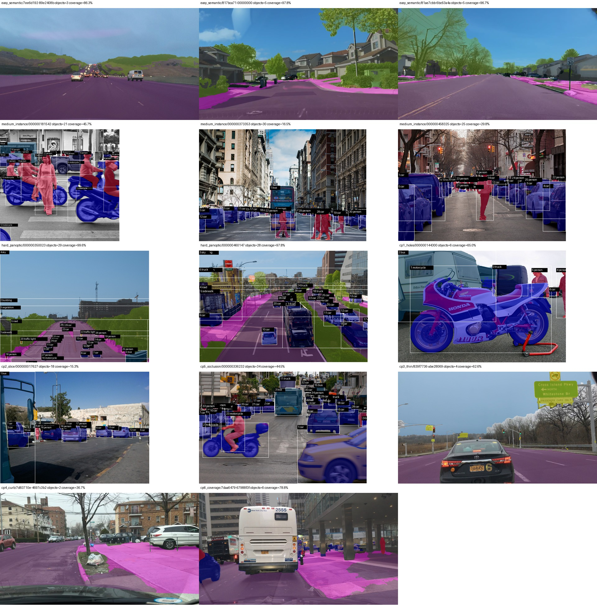

# Review bản mask AI Day03

**Chờ học viên kiểm lại trước khi tự nộp LMS.** Preview là lớp mask phủ trên cảnh; ảnh gốc được liên kết tới dữ liệu đã có trong repo, không upload thêm bản sao JPG gốc. Số mask không phải số object đúng; coverage không phải accuracy. Không có ground truth trong thư mục này.

| Task / ảnh | Mask theo class | Coverage vùng đã gán | Preview | Ảnh gốc trong repo |
| --- | --- | ---: | --- | --- |
| `easy_semantic/7ee6d192-89e2408b.jpg` | road: 1, vegetation: 1, sky: 1 | 86.25% | [Mask](easy_semantic_7ee6d192-89e2408b.jpg) | [Gốc](../../data/tiers/easy_semantic/images/7ee6d192-89e2408b.jpg) |
| `easy_semantic/817bca71-00000000.jpg` | road: 1, sidewalk: 1, building: 1, vegetation: 1, sky: 1 | 97.82% | [Mask](easy_semantic_817bca71-00000000.jpg) | [Gốc](../../data/tiers/easy_semantic/images/817bca71-00000000.jpg) |
| `easy_semantic/81ae7cbb-6bc63a4a.jpg` | road: 1, sidewalk: 1, building: 1, vegetation: 1, sky: 1 | 96.68% | [Mask](easy_semantic_81ae7cbb-6bc63a4a.jpg) | [Gốc](../../data/tiers/easy_semantic/images/81ae7cbb-6bc63a4a.jpg) |
| `medium_instance/000000181542.jpg` | motorcycle: 5, person: 12, bus: 1, truck: 1, car: 2 | 45.75% | [Mask](medium_instance_000000181542.jpg) | [Gốc](../../data/tiers/medium_instance/images/000000181542.jpg) |
| `medium_instance/000000373353.jpg` | bus: 1, car: 20, person: 9 | 16.45% | [Mask](medium_instance_000000373353.jpg) | [Gốc](../../data/tiers/medium_instance/images/000000373353.jpg) |
| `medium_instance/000000458325.jpg` | car: 14, person: 10, motorcycle: 1 | 29.79% | [Mask](medium_instance_000000458325.jpg) | [Gốc](../../data/tiers/medium_instance/images/000000458325.jpg) |
| `hard_panoptic/000000350023.jpg` | sidewalk: 1, building: 1, vegetation: 1, sky: 1, road: 1, bus: 1, car: 15, motorcycle: 1, person: 5, traffic light: 2 | 99.60% | [Mask](hard_panoptic_000000350023.jpg) | [Gốc](../../data/tiers/hard_panoptic/images/000000350023.jpg) |
| `hard_panoptic/000000460147.jpg` | building: 1, vegetation: 1, sky: 1, road: 1, sidewalk: 1, truck: 4, car: 19 | 97.83% | [Mask](hard_panoptic_000000460147.jpg) | [Gốc](../../data/tiers/hard_panoptic/images/000000460147.jpg) |
| `cp1_holes/000000144300.jpg` | motorcycle: 1, bus: 1, truck: 1, person: 2, car: 1 | 65.01% | [Mask](cp1_holes_000000144300.jpg) | [Gốc](../../data/checkpoints/cp1_holes/images/000000144300.jpg) |
| `cp2_slice/000000017627.jpg` | bus: 1, car: 12, person: 5 | 15.29% | [Mask](cp2_slice_000000017627.jpg) | [Gốc](../../data/checkpoints/cp2_slice/images/000000017627.jpg) |
| `cp5_occlusion/000000336232.jpg` | car: 22, motorcycle: 3, bus: 2, person: 5, truck: 2 | 44.50% | [Mask](cp5_occlusion_000000336232.jpg) | [Gốc](../../data/checkpoints/cp5_occlusion/images/000000336232.jpg) |
| `cp3_thin/839f7736-abe28069.jpg` | road: 1, pole: 1, traffic sign: 1, sky: 1 | 62.62% | [Mask](cp3_thin_839f7736-abe28069.jpg) | [Gốc](../../data/checkpoints/cp3_thin/images/839f7736-abe28069.jpg) |
| `cp4_curb/7d83710e-4697c3b2.jpg` | road: 1, sidewalk: 1 | 36.69% | [Mask](cp4_curb_7d83710e-4697c3b2.jpg) | [Gốc](../../data/checkpoints/cp4_curb/images/7d83710e-4697c3b2.jpg) |
| `cp6_coverage/7daa6479-67988f3f.jpg` | road: 1, sidewalk: 1, building: 1, sky: 1, person: 1, car: 1 | 78.85% | [Mask](cp6_coverage_7daa6479-67988f3f.jpg) | [Gốc](../../data/checkpoints/cp6_coverage/images/7daa6479-67988f3f.jpg) |

Các ca cần quyết định được ghi trong [report cá nhân](../individual/2A202603206_PhungDanhKhoa.md#4-ba-ca-chưa-chắc-hoặc-đã-cân-nhắc).

Bản preview không thay ZIP đã export từ CVAT.
